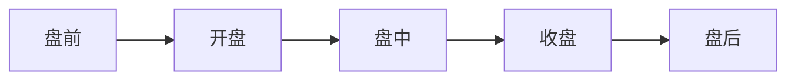

# 盘
：交易市场。
>指的是，不断跳动的、像仪表盘一样的报价、成交情况，后来就代指交易市场。
## 交易的过程

### 交易中的时间结点
==不同类型的股票不同==

| 股票类型       | 盘前交易时间      | 开盘时间~收盘时间            | 盘后交易时间    |
| ---------- | ----------- | -------------------- | --------- |
| A股         |             | **北京时间**：9:30~15:00  |           |
| 港股         |             | **北京时间**：9:30~16:00  |           |
| 美股(冬令时+1h) | 16:00~21:30 | (**夏令时**) 21:30~4:00 | 4:00~8:00 |
| ……         |             |                      |           |

## 开盘
：开始交易
### 开盘价
：当天第一笔成交的价格，为开盘价。
## 盘中
：交易进行中
## 收盘
：结束交易
### 收盘价
：当天最后一笔交易成交的价格，为收盘价。

